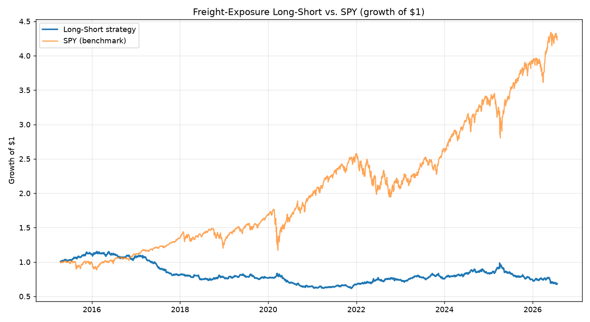

# signal-lab

A signal research engine for equity long-short strategies driven by **alternative
data**. It tests a real-world hypothesis with proper statistics and a
cost-aware backtest, so you can tell a genuine tradeable edge from noise.

## The current thesis
When global **freight / shipping costs spike**, retailers that import most of
their goods eat higher landed costs they can't fully pass on → margin squeeze.
The market is slow to reprice the lag. So we **short high-import** names and
**long low-import** names in a market-neutral book.

The point isn't that this one signal prints money — it's the *framework* and the
*rigor*: mechanism stated first, out-of-sample testing, honest net-of-cost stats.

## Quick start
```bash
python -m venv .venv
# Windows:
.venv\Scripts\activate
pip install -r requirements.txt
python main.py
```
This downloads prices, builds the long-short book, prints performance stats, and
saves `output/strategy_vs_spy.png`.

## Milestone 1 result (and why the "loss" is the point)


The first version is an **always-on** book: permanently short importers, long
domestic names. Backtested 2015–2026 it *underperforms* SPY (Sharpe ≈ **-0.25**
vs SPY's 0.81). That's expected and instructive: freight costs weren't elevated
most of that window, so the book spent years structurally short high-growth
retailers straight through a bull market — fighting the market, not trading the
signal.

The fix (Milestone 2) is to make the signal **conditional**: only lean short-
importer *when freight is actually spiking*, and sit flat otherwise. Reporting
the honest v1 result and the flaw it exposes is deliberate — it reflects how real
signal research actually proceeds.

## Layout
- `src/universe.py` — the stock list, the thesis, and per-stock import-exposure scores
- `src/ingest.py` — pull + cache price data (yfinance)
- `src/backtest.py` — build long-short weights, backtest, performance stats
- `main.py` — runs the whole first milestone end-to-end

## Roadmap
1. **Milestone 1 (this):** static thesis book vs. SPY, one chart. ✅
2. **Milestone 2:** dynamic signal — drive weights off a live freight series
   (Cass Freight Index / Freightos Baltic Index). Add lag handling.
3. **Milestone 3:** validation layer — Granger causality, information
   coefficient, train/test out-of-sample split, multiple-testing correction.
4. **Milestone 4:** Streamlit dashboard + a one-page written thesis.

## Honesty notes
Research tool, not live trading. Freight→margin effects are real but noisy —
expect a modest Sharpe, and report it honestly. That candor is what makes it
credible on a desk.
